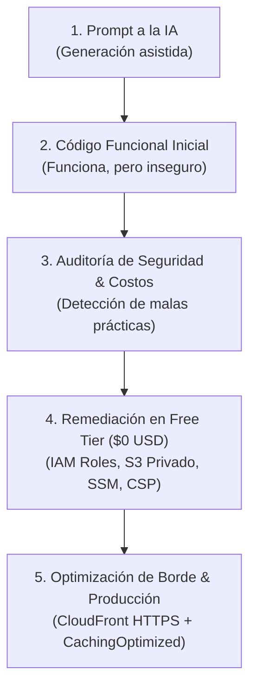

# Muro de saludos: laboratorio de despliegue en AWS

> Material técnico práctico desarrollado para el AWS Student Community Day Chile 2026.
> Autor: Roberto Flores Segundo (Siegfried), fundador y líder del AWS User Group Playa Vicente.
> Enfoque: Despliegue en capa gratuita (Free Tier a $0.00 USD), remediación de configuraciones vulnerables y auditoría operativa.
> 🚀 **Demo en vivo (CloudFront + HTTPS):** [https://d2adwmd20lwrlw.cloudfront.net/](https://d2adwmd20lwrlw.cloudfront.net/)

---

## Resumen del proyecto

Este repositorio contiene el código fuente de una aplicación web construida con Flask para registrar saludos y fotografías durante eventos comunitarios.

El laboratorio ilustra la evolución de un desarrollo generado con asistencia de inteligencia artificial: desde una versión inicial con riesgos comunes de seguridad hasta una arquitectura mitigada que opera dentro de los límites de la capa gratuita de AWS.

---

## El flujo de trabajo con IA: del Prompt a la Arquitectura Segura

Cualquier estudiante o desarrollador puede pedirle hoy a una IA que construya una aplicación web en segundos. Sin embargo, **la inteligencia artificial siempre arroja resultados diferentes según el modelo o cómo formules la solicitud**, y casi siempre optimiza para que el código *funcione rápido*, entregando configuraciones por defecto que arrastran malas prácticas de seguridad o arquitectura.

Si deseas **replicar exactamente lo que construí en este laboratorio** o probarlo con distintas herramientas de IA (Claude, ChatGPT, Amazon Q Developer, Gemini), aquí tienes el prompt maestro original y el flujo completo.

### El Prompt Maestro utilizado con la IA

```text
Actúa como un desarrollador Full Stack experto en Python y AWS.

Necesito que me construyas una aplicación web completa y lista para desplegar en una instancia Amazon EC2 (Amazon Linux 2023 o Ubuntu) para el evento "AWS Student Community Day Chile 2026".

La app será un "Muro de Saludos de la Comunidad Estudiantil":
1. Una interfaz web moderna, responsiva, con tema oscuro elegante y acentos en los colores oficiales de AWS (naranja #FF9900 y azul marino) con un toque sutil representativo de Chile en el encabezado.
2. Título principal visible: "Muro de Saludos — AWS Student Community Day Chile 2026".
3. Formulario donde los estudiantes ingresen:
   - Nombre completo.
   - Universidad, Instituto o Comunidad (ej: Duoc UC Maipú, etc.).
   - Mensaje de saludo para la comunidad.
   - Campo para subir una foto o avatar del evento.
4. Muro visual debajo del formulario donde se muestren en tarjetas (cards) los mensajes publicados junto con la foto que subieron.

Requerimientos técnicos del código:
- Usa Python con Flask y plantillas en HTML con Tailwind CSS (vía CDN para no complicar el build).
- Las fotos que suban los estudiantes deben guardarse en un bucket de Amazon S3 que yo cree.
- Escribe el código en un solo archivo app.py y templates/index.html para que sea muy fácil de entender y ejecutar.
- Incluye cómo configurar las credenciales de AWS (Access Key ID y Secret Access Key) para que la app se conecte con el bucket de S3.
- Dame los comandos exactos de terminal para clonar, instalar dependencias, levantar el servidor en el puerto 5000 o 80 en mi EC2.
- Incluye las instrucciones paso a paso de qué puertos debo abrir en el Security Group de AWS y qué permisos darle al bucket de S3 para que las fotos se vean públicamente en el navegador de cualquier asistente desde su celular.
```

### El Flujo Completo: De la trampa de la IA al estándar de producción



1. **La trampa de la IA:**  
   Al pedirle a la IA conectar la app y mostrar las fotos, la respuesta por defecto fue: *"Pega tus llaves de acceso (`AWS_ACCESS_KEY_ID`) en el código, haz el bucket de S3 100% público y abre el puerto 22 a `0.0.0.0/0`"*. Funciona de inmediato, pero viola los principios de Well-Architected Framework.
2. **El rol del Cloud Builder:**  
   El valor no reside en picar código de memoria, sino en **entender la nube, auditar lo que la IA entrega y aplicar las mejores prácticas oficiales**.
3. **El camino de remediación a costo $0.00 USD:**  
   * **IAM Instance Profile:** Reemplaza llaves de acceso estáticas por credenciales rotativas automáticas.
   * **S3 Block Public Access + URLs prefirmadas (SigV4):** Bucket 100% blindado sin acceso público, generando enlaces firmados con expiración.
   * **AWS Systems Manager (Session Manager):** Gestión remota por consola web sin abrir el puerto SSH 22.
   * **Middleware de cabeceras HTTP:** Content Security Policy (CSP) y protección contra clickjacking.
   * **Amazon CloudFront (Always Free):** Cifrado SSL/TLS oficial y reducción de latencia de 344 ms a **14 ms** hacia Sudamérica.

---

## Comparativa técnica: del prototipo inicial a la configuración segura

En entornos formativos y hackathones es habitual que los asistentes de inteligencia artificial entreguen código funcional pero con malas prácticas operativas. Este laboratorio implementa las remediaciones correspondientes:

| Control | Enfoque vulnerable común | Remediación aplicada en este laboratorio | Impacto en costo |
| :--- | :--- | :--- | :--- |
| **Credenciales** | Llaves de acceso fijas (`AWS_ACCESS_KEY_ID`) en archivos locales o código fuente. | Rol de IAM (Instance Profile) asociado a la instancia EC2. Boto3 obtiene credenciales temporales automáticamente. | $0.00 USD |
| **Almacenamiento** | Desactivación de Block Public Access y políticas de lectura pública global en S3. | Bucket privado con Block Public Access activado al 100% y entrega de imágenes mediante URLs prefirmadas temporales (SigV4). | $0.00 USD |
| **Administración** | Puerto SSH 22 abierto hacia `0.0.0.0/0`. | Conexión administrativa mediante AWS Systems Manager (Session Manager) sin puertos de entrada expuestos. | $0.00 USD |
| **Cabeceras HTTP** | Servidor web sin cabeceras de respuesta (calificación F en auditoría). | Middleware en Flask con Content Security Policy, X-Frame-Options, X-Content-Type-Options y Referrer-Policy (calificación A). | $0.00 USD |

---

## Estructura del repositorio

```text
muro-comunidad-aws-chile/
├── app.py              # Aplicación Flask con URLs prefirmadas y cabeceras de seguridad
├── requirements.txt    # Dependencias del proyecto (Flask, boto3, gunicorn, python-dotenv)
├── .env.example        # Plantilla de variables de entorno (sin credenciales fijas)
├── .gitignore          # Exclusión de archivos locales sensibles y bases de datos
├── LICENSE             # Licencia de código abierto MIT
└── templates/
    └── index.html      # Plantilla HTML responsive con visor interactivo de fotos
```

---

## Guía de despliegue paso a paso en Free Tier

### 1. Creación del bucket en Amazon S3

1. Ingrese a la consola de AWS y diríjase al servicio **Amazon S3**.
2. Seleccione **Crear bucket**.
3. Asigne un nombre único a nivel global (por ejemplo: `muro-saludos-chile-tunombre-2026`).
4. Seleccione la región donde desplegará su cómputo (por ejemplo: `us-east-1` o `sa-east-1`).
5. Verifique que la opción **Bloquear todo el acceso público** permanezca activada con sus cuatro casillas seleccionadas.
6. Haga clic en **Crear bucket**.

---

### 2. Creación del rol de IAM para Amazon EC2

Para evitar el uso de credenciales estáticas en el servidor, cree un rol que permita a la instancia interactuar con Amazon S3 y AWS Systems Manager:

1. Diríjase a **IAM** > **Roles** > **Crear rol**.
2. Seleccione **Servicio de AWS** como tipo de entidad de confianza y elija el caso de uso **EC2**.
3. Adjunte la política administrada **AmazonSSMManagedInstanceCore** para habilitar la administración mediante Session Manager sin necesidad de abrir el puerto 22.
4. Agregue una política en línea con permisos estrictos de menor privilegio sobre el bucket creado:

```json
{
  "Version": "2012-10-17",
  "Statement": [
    {
      "Sid": "PermitirAccesoS3MuroSaludos",
      "Effect": "Allow",
      "Action": [
        "s3:PutObject",
        "s3:GetObject"
      ],
      "Resource": "arn:aws:s3:::TU_NOMBRE_DE_BUCKET/saludos/*"
    }
  ]
}
```

5. Asigne el nombre `MuroEstudiantilEC2Role` y complete la creación del rol.

---

### 3. Lanzamiento de la instancia Amazon EC2

1. Diríjase a **EC2** > **Lanzar una instancia**.
2. Nombre: `muro-estudiantil-chile`.
3. Imagen de máquina (AMI): **Amazon Linux 2023 AMI** (elegible para la capa gratuita).
4. Tipo de instancia: `t2.micro` (o `t3.micro` según disponibilidad regional de Free Tier).
5. Par de claves: puede omitir la creación de llave privada si administrará el equipo mediante AWS Systems Manager.
6. Grupo de seguridad (Security Group):
   * Regla de entrada: Permitir tráfico **HTTP (puerto 80)** con origen `0.0.0.0/0`.
   * Si requiere SSH (puerto 22), configure como origen únicamente su dirección IP pública actual (`Mi IP / 32`).
7. En la sección **Detalles avanzados**:
   * En el campo **Perfil de instancias de IAM**, seleccione `MuroEstudiantilEC2Role`.
8. Seleccione **Lanzar instancia**.

---

### 4. Conexión y preparación del entorno

Conéctese a la instancia mediante **Session Manager** o **EC2 Instance Connect** desde la consola de AWS y ejecute los siguientes comandos:

```bash
# Actualización del sistema e instalación de paquetes requeridos
sudo dnf update -y
sudo dnf install -y python3 python3-pip git

# Clonación del repositorio
git clone https://github.com/Siegfried-FS/muro-comunidad-aws-chile.git
cd muro-comunidad-aws-chile

# Creación de entorno virtual y carga de librerías
python3 -m venv .venv
source .venv/bin/activate
pip install -r requirements.txt

# Configuración del archivo de entorno
cp .env.example .env
nano .env
```

En el archivo `.env`, configure únicamente el nombre del bucket y la región:

```dotenv
AWS_REGION=us-east-1
S3_BUCKET=TU_NOMBRE_DE_BUCKET
IMAGE_URL_MODE=presigned
FLASK_SECRET_KEY=clave-aleatoria-generada-para-la-sesion
```

Las variables `AWS_ACCESS_KEY_ID` y `AWS_SECRET_ACCESS_KEY` deben quedar vacías. La librería Boto3 asumirá automáticamente las credenciales temporales provistas por el rol de IAM asociado a la instancia.

---

### 5. Ejecución del servicio en producción

Para servir la aplicación en el puerto HTTP estándar (puerto 80), ejecute Gunicorn mediante privilegios administrativos:

```bash
sudo .venv/bin/gunicorn -w 2 -b 0.0.0.0:80 app:app
```

Si prefiere mantener el proceso en ejecución continua mediante `systemd`:

```bash
sudo tee /etc/systemd/system/muro.service > /dev/null <<'EOF'
[Unit]
Description=Muro de Saludos AWS Chile 2026
After=network.target

[Service]
User=ec2-user
WorkingDirectory=/home/ec2-user/muro-comunidad-aws-chile
ExecStart=/home/ec2-user/muro-comunidad-aws-chile/.venv/bin/gunicorn -w 2 -b 0.0.0.0:80 app:app
Restart=always

[Install]
WantedBy=multi-user.target
EOF

sudo systemctl daemon-reload
sudo systemctl enable --now muro
```

---

## Verificación de costos y desmantelamiento

Para garantizar que el laboratorio no genere cobros posteriores en su cuenta de AWS, siga el procedimiento de desmantelamiento una vez concluida la práctica:

1. **Eliminar objetos de Amazon S3:** Vacíe el prefijo `saludos/` y elimine el bucket si ya no lo utilizará.
2. **Terminar la instancia Amazon EC2:** Seleccione la instancia en la consola y ejecute **Estado de la instancia** > **Terminar instancia**.
3. **Validación obligatoria por AWS CLI:** Compruebe que la instancia se encuentre formalmente en estado `terminated` para evitar cargos derivados de volúmenes EBS residuales:

```bash
aws ec2 describe-instances \
  --filters "Name=tag:Name,Values=muro-estudiantil-chile" \
  --query "Reservations[*].Instances[*].[InstanceId,State.Name]" \
  --output table
```

---

## Optimización de latencia y CloudFront Always Free: lo que casi nadie te cuenta

Una duda recurrente en hackathones y eventos estudiantiles es cómo evitar el retardo (lag) sin incurrir en costos imprevistos:

### 1. El dilema de la latencia regional (Virginia vs. Sudamérica)
* **Virginia (`us-east-1`):** Servir tráfico hacia Chile desde Norteamérica implica recorrer cables submarinos transcontinentales, generando un tiempo de respuesta (*TTFB*) de **~145 a 160 ms**.
* **São Paulo (`sa-east-1`):** Mantener el servidor dentro del continente sudamericano reduce la latencia a **~48 ms** (aproximadamente tres veces más rápido para usuarios en Chile).

### 2. Mitos derribados sobre Amazon CloudFront
Muchos estudiantes evitan usar Content Delivery Networks (CDN) por miedo a la facturación. Las condiciones reales del servicio son:

* **Es Always Free (Gratis de por vida):** CloudFront **no expira a los 12 meses** del Free Tier inicial. AWS otorga de manera permanente **1 TB (1,000 GB)** de transferencia de salida mensual y **10,000,000 de solicitudes HTTP/HTTPS** a costo $0.00 USD.
* **Cero costo fijo por existencia:** No existe tarifa mensual ni costo por hora por tener distribuciones creadas. Si tu proyecto no recibe visitas, tu factura se mantiene en $0.00 USD.
* **Certificado SSL/TLS gratis con ACM:** Al colocar CloudFront al frente de tu EC2 o S3, puedes emitir un certificado HTTPS válido mediante AWS Certificate Manager (`us-east-1`) sin costo.
* **Puntos de presencia locales:** CloudFront cuenta con *Edge Locations* en Santiago de Chile, resolviendo contenido estático en menos de **15 ms**.

### 3. Buenas prácticas para builders y ponentes (Crear y destruir proyectos)
* **Las cuotas son simultáneas, no acumulativas:** El límite por defecto de 200 distribuciones por cuenta aplica a recursos activos al mismo tiempo. Al eliminar un laboratorio o cerrar una cuenta de pruebas en tu AWS Organization, la cuota se libera íntegramente.
* **El contador mensual reinicia a cero:** Cada día 1 de mes calendario, tu bolsa de 1 TB gratuito de CloudFront vuelve a estar disponible al 100%.

### 4. Lecciones prácticas y solución de problemas (Lo que me tocó vivir)
Durante las pruebas de estrés y preparación de este laboratorio surgieron desafíos reales que ilustran cómo opera la nube:

1. **El misterio de la IP que dejó de responder (IP dinámica vs. Elástica vs. CloudFront):**  
   Al reiniciar la instancia EC2, AWS reasignó una nueva IP pública dinámica, rompiendo los enlaces previos. En lugar de incurrir en costos reservando una IP Elástica fija, la solución más limpia y económica fue colocar **CloudFront** al frente: entrega una URL permanente (`https://d2adwmd20lwrlw.cloudfront.net/`) a costo $0.00 USD.
2. **El bloqueo de ICMP (¿Por qué `ping` no respondía en la terminal?):**  
   Al intentar medir latencia con `ping`, la terminal reportaba *100% packet loss*. Esto no significa que el servidor esté caído: los Security Groups de AWS bloquean el protocolo ICMP por defecto por seguridad. Para medir tiempos de respuesta web de forma confiable, la herramienta adecuada es `curl`:
   ```bash
   curl -o /dev/null -s -w "Tiempo total: %{time_total}s\n" https://d2adwmd20lwrlw.cloudfront.net/
   ```
3. **El obstáculo de 'HTTPS-First' en teléfonos móviles:**  
   Al compartir una IP pública directa en puerto 80 (HTTP), los navegadores móviles modernos fuerzan `https://` por defecto y muestran *"Conexión rechazada"* por ausencia de certificado SSL. Con CloudFront, el tráfico se redirige automáticamente a HTTPS con certificado emitido por AWS sin errores en navegadores móviles.
4. **Caché desactivada vs. Caché optimizada (De 344 ms a 14 ms):**  
   Si CloudFront opera sin caché (`CachingDisabled`), cada petición está obligada a cruzar el océano hasta el servidor de origen en Virginia (~340 ms). Al aplicar la política administrada **`CachingOptimized`**, CloudFront almacena los objetos en la memoria RAM del Edge Location más cercano, reduciendo la respuesta a solo **14 ms (una aceleración de más de 24 veces)**.

---

## Autor y comunidad

Este proyecto fue desarrollado por:

* **Roberto Flores Segundo (Siegfried)**
  * Fundador y líder del **AWS User Group Playa Vicente** | Formador técnico y divulgador cloud.
  * Certificaciones: AWS Certified Cloud Practitioner | Lead Auditor ISO/IEC 27001:2022.
  * Perfil profesional: [linkedin.com/in/siegfried-fs](https://www.linkedin.com/in/siegfried-fs/)
  * Enlaces y publicaciones de comunidad: [linktr.ee/siegfried_fs](https://linktr.ee/siegfried_fs)

---

## Licencia

Este proyecto se distribuye bajo los términos de la licencia [MIT](LICENSE). Código libre para estudio, reproducción y adaptación en comunidades técnicas y académicas.
